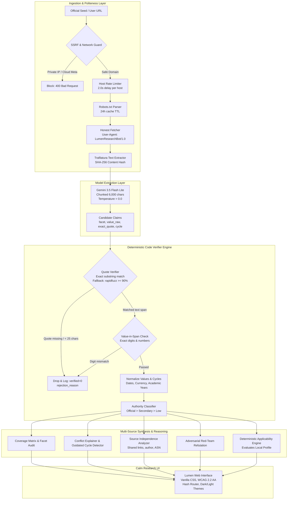

# Lumen

> **Lumen is an AI-assisted information-gap detection and evidence verification platform.**
> **It ingests high-stakes public portals, schemes, scholarships, and academic admissions.**
> **It extracts atomic factual claims backed by exact verbatim quotes from source documents.**
> **It runs deterministic code verifiers to prove every claim, expose conflicts, and flag outdated cycles.**
> **It computes what is missing, who qualifies, and concrete next actions with zero hallucinations.**

---

## The Societal Problem

Critical public information for education, career pathways, government subsidies, and small business support is scattered across hundreds of disconnected portals. In high-stakes domains—such as national scholarships, competitive entrance examinations, and welfare grants—information is often outdated, contradictory, mirrored by low-quality aggregator websites, or deliberately fabricated by scam operators charging bogus registration fees.

First-generation students, rural families, job seekers, and small enterprise owners routinely lose critical deadlines, forfeit life-changing financial aid, or fall prey to fraudulent lookalike portals. Standard AI chatbots exacerbate this vulnerability: large language models smoothly hallucinate eligibility criteria, synthesize plausible but nonexistent deadlines, and blur old academic cycles with current ones without citations.

**Lumen solves this by transforming unverified web content into audited, code-proven knowledge.** Every fact in Lumen is tethered to an exact, verified verbatim quote in the original text, cross-checked for numeric fidelity, classified by domain authority, tested against red-team counter-hypotheses, and evaluated for applicability against a private, local-only user profile.

---

## Architecture

Lumen uses a clean, evidence-first pipeline where the generative model is strictly restricted to text extraction, while all verification, quote matching, numeric validation, conflict detection, and authority classification are executed by deterministic Python logic.



---

## Verification Rules

1. **Quote Verification**: The LLM extracts an `exact_quote` (minimum 25 characters to prevent vague 1-word proofs). Deterministic Python code searches for this quote in the raw document text using exact substring matching first, falling back to `rapidfuzz` partial ratio alignment with a strict $\ge 90\%$ threshold. If the quote is missing or too short, the claim is rejected.
2. **Value-in-Span Enforcement**: All digits, dates, and currency values present in `value_raw` must literally appear inside the matched text span in the original document. If a model reports an amount of ₹3,50,000 but the matched span contains ₹1,50,000, the claim is rejected with `"Value digits do not appear in the matched source span"`.
3. **Normalization**: Currency (e.g., `"Rs. 2,50,000"`, `"2.5 Lakhs"` $\rightarrow$ `250000.0 INR`), dates (ISO-8601 `YYYY-MM-DD`), and version cycles (`"2025-26"` $\rightarrow$ `2025-2026`) are converted to standard canonical formats for strict mathematical comparison.
4. **Authority Classification**:
   - **Official**: Domains ending in `.gov.in`, `.nic.in`, `.ac.in`, `.edu`, or matching the confirmed primary agency domain.
   - **Secondary**: Reputable news publications, academic publishers, and national statutory boards (`thehindu.com`, `ugc.ac.in`).
   - **Low**: Unverified blogs, coaching portals, social media aggregators (`sarkariresult`, `wordpress`, `collegedunia`).
5. **Source Independence**: Detects when secondary sources merely copy official announcements by checking domain co-ownership, cross-referencing outbound anchor links, and inspecting network ASN data. Independent validation requires distinct corporate entities.
6. **Red-Team Counter-Hypothesis**: Adversarially probes claims for conflicting exceptions, expiration dates, hidden eligibility caps, and non-renewal traps before confirming a claim.

---

## How to Run

### Prerequisites
- Python 3.10+ (tested on Python 3.14 on Windows)
- Modern web browser (Chrome, Edge, Firefox)

### Windows Command Line Setup

```powershell
# 1. Clone or navigate to the repository
cd c:\Users\kshitij\OneDrive\Desktop\projects\lumen

# 2. Install dependencies
python -m pip install -r requirements.txt

# 3. Configure environment
copy .env.example .env

# 4. Launch the application
python -m uvicorn app.main:app --host 127.0.0.1 --port 8000 --reload
```

Open your browser at **`http://127.0.0.1:8000`**.

---

## Environment Configuration (`.env.example`)

```ini
# Lumen Configuration
# Optional: If GEMINI_API_KEY is unset or FORCE_MOCK=true, the platform runs in deterministic offline fixture mode
GEMINI_API_KEY=
GEMINI_MODEL=gemini-3.5-flash-lite
FORCE_MOCK=false

# Politeness & Ingestion
CONTACT_URL=https://github.com/kshitij-verma-27/Lumen

# Database override (used for test isolation)
DARKSPOT_DB=darkspot.db

# Server settings
PORT=8000
HOST=127.0.0.1
DEBUG=True
```

---

## Mock vs Live Mode

Lumen operates transparently in two modes, visibly communicated across every view:

| Feature | Live Gemini Mode | Deterministic Mock / Offline Mode |
|---|---|---|
| **Trigger** | `GEMINI_API_KEY` configured and valid in `.env` | `GEMINI_API_KEY` unset or `FORCE_MOCK=true` |
| **Model** | `gemini-3.5-flash-lite` via `@google/genai` SDK | Built-in regex and template fixture extractor |
| **Network** | Real HTTP requests rate-limited to 1 req / 2.0s per host | Local SQLite cached snapshots only |
| **Audit Label** | Marked as `audit_mode = live` | Marked as `audit_mode = mock` |
| **Safety** | SSRF prevention and robots.txt strictly enforced | 100% offline, zero network egress |

---

## How to Run Tests

All test suites run with isolated databases via the `DARKSPOT_DB` environment variable so test fixtures never pollute the production `darkspot.db`.

```powershell
# Run the complete test suite (10/10 test suites)
python scripts/run_all_suites.py

# Or run individual suites:
python test_phase1.py                       # Politeness, scam detection, audit integrity
python test_phase2.py                       # Ingestion, SSRF guard, entity normalization
python test_l1.py                           # Core quote verifier & adversarial checks
python test_l2.py                           # Normalizers, gap detection, consequence checklist
python test_l3_matrix.py                    # Coverage matrix, conflicts, cycle detection
python test_all_topics.py                   # Multi-domain tests (scholarships, exams, schemes)
python test_source_independence.py          # Independence scoring & circular citation checks
python test_new_batch.py                    # Multi-source batch ingestion
python test_documents_and_cycle_override.py # Document cycle validation
python test_phase4_phase5.py                # Source detail API, re-check watch, SSRF security
```

---

## 3-Minute Demo Script

Follow this step-by-step walkthrough to evaluate Lumen's core capabilities:

1. **Minute 1: Explore Stored Entities & Coverage**
   - Navigate to `http://127.0.0.1:8000/#/` (Home View).
   - Press `/` to focus the search bar. Search for `"PM-USP"` or `"National Means"`.
   - Click **PM-USP Central Sector Scheme**. Notice the **"Demo snapshot taken 2026-11-01"** banner with the **"↻ Refresh Live"** button.
   - Inspect the **Redaction Bars**: Missing attributes are highlighted with clear explanations of what is missing.
   - Click any verified claim to view its exact verbatim quote and character offsets.

2. **Minute 2: Personalize with Local Profile & Applicability**
   - Click **"My Profile"** in the top navigation.
   - Set status to `"Student"`, category to `"General"`, and state to `"Uttar Pradesh"`. Click **"Save Profile"**.
   - Notice the plain note: *"Stored only on this device. Never sent to an external server."*
   - Return to the PM-USP page. Attributes now display dynamic applicability badges:
     - *"applies to you / does not / unclear"* with a one-line reason and the mandatory disclaimer: *"potential signal, verify with the official source"*.

3. **Minute 3: Source Verification & Live Investigation**
   - Click the **"Sources"** tab on the entity page, then click the source link to open `#/source/:id`.
   - View the source trust badge, reachability status, robots.txt status, SHA-256 content hash, and list of extracted entities.
   - Click **"Re-check Now"** to test the change-watch monitor with the note: *"any text change counts, including small page edits"*.
   - Navigate to `#/registry` to inspect the 29 official seeds or validate a new portal URL with automated SSRF protection.

---

## Honest Limitations (Computed from Stored Data)

All statistics and portal names in this section are dynamically computed from stored SQLite audit records (`registry_sources` table):

- **Seed Coverage**: The registry contains **29 official seeds** across 5 national sectors (Education, Careers, Public Services, Research, Business).
- **Directly Reachable**: In our live polite audit (`User-Agent: LumenResearchBot/1.0`), **15 portals** (including `https://nta.ac.in` and `https://udyamregistration.gov.in`) are directly reachable with full HTML text content.
- **Client-Side JavaScript / SPA Hydration**: **6 portals** (*National Career Service (NCS)*, *Skill India Digital*, *Staff Selection Commission (SSC)*, *PM Surya Ghar*, *UMANG*, and *Department of Science and Technology (DST)*) return HTTP 200 but yield thin initial HTML markup because their content is rendered dynamically via client-side JavaScript.
- **HTTP 403 Responses**: **7 portals** (*DPIIT Industrial Promotion*, *Goods and Services Tax (GST)*, *Ministry of Corporate Affairs (MCA)*, *UPSC*, *NIRF*, *National Portal of India*, and *Open Government Data Platform*) returned HTTP 403 to our automated request.
- **Unenrolled Portals**: Portals not registered in `data/registry.yaml` (such as *JoSAA*) are not crawled by default; they can be added on-demand via `#/registry` with automated SSRF verification.
- **Evaded Blocks**: Lumen **never** spoofs consumer browsers, rotates evasive residential proxies, or attempts to bypass HTTP blocks. If a server denies automated access, Lumen honestly records HTTP 403 and provides a manual text-paste fallback.

---

## Ethics and Privacy

- **Polite Crawling**: Strict per-host rate limiting enforces a minimum 2.0-second delay between requests to the same server.
- **Honest User-Agent**: Every outgoing HTTP request identifies itself transparently as `LumenResearchBot/1.0 (+https://github.com/kshitij-verma-27/Lumen; research-notebook)`.
- **Robots.txt Adherence**: Robots exclusion standards are fetched, parsed, and cached with a 24-hour TTL. Disallowed paths are strictly skipped.
- **SSRF Network Guard**: Blocks all loopback (`127.0.0.1`), private RFC-1918 ranges (`10.0.0.0/8`, `192.168.0.0/16`, `172.16.0.0/12`), link-local addresses, and cloud provider metadata endpoints (`169.254.169.254`).
- **Zero PII Transmission**: User profiles (age, student status, field, income) reside **exclusively** in the client's browser `localStorage`. Personal details, names, and college names are never transmitted to the LLM or any remote server.
- **No Hallucinated Advice**: Career, scholarship, and eligibility signals are strictly labelled as *"potential options to verify"*—never definitive legal or career advice.

---

## Screenshots Gallery

All views have been captured at **1440px (Desktop)** and **360px (Mobile)** in both **Light** and **Dark** themes:

| Screen | 1440px Light (Desktop) | 1440px Dark (Desktop) | 360px Light (Mobile) | 360px Dark (Mobile) |
|---|---|---|---|---|
| **Home Screen** | [View](file:///c:/Users/kshitij/OneDrive/Desktop/projects/lumen/docs/screens/home_1440px_light.png) | [View](file:///c:/Users/kshitij/OneDrive/Desktop/projects/lumen/docs/screens/home_1440px_dark.png) | [View](file:///c:/Users/kshitij/OneDrive/Desktop/projects/lumen/docs/screens/home_360px_light.png) | [View](file:///c:/Users/kshitij/OneDrive/Desktop/projects/lumen/docs/screens/home_360px_dark.png) |
| **Entity Page (Redactions)** | [View](file:///c:/Users/kshitij/OneDrive/Desktop/projects/lumen/docs/screens/entity_1440px_light.png) | [View](file:///c:/Users/kshitij/OneDrive/Desktop/projects/lumen/docs/screens/entity_1440px_dark.png) | [View](file:///c:/Users/kshitij/OneDrive/Desktop/projects/lumen/docs/screens/entity_360px_light.png) | [View](file:///c:/Users/kshitij/OneDrive/Desktop/projects/lumen/docs/screens/entity_360px_dark.png) |
| **Investigation View** | [View](file:///c:/Users/kshitij/OneDrive/Desktop/projects/lumen/docs/screens/investigation_1440px_light.png) | [View](file:///c:/Users/kshitij/OneDrive/Desktop/projects/lumen/docs/screens/investigation_1440px_dark.png) | [View](file:///c:/Users/kshitij/OneDrive/Desktop/projects/lumen/docs/screens/investigation_360px_light.png) | [View](file:///c:/Users/kshitij/OneDrive/Desktop/projects/lumen/docs/screens/investigation_360px_dark.png) |
| **Registry Manager** | [View](file:///c:/Users/kshitij/OneDrive/Desktop/projects/lumen/docs/screens/registry_1440px_light.png) | [View](file:///c:/Users/kshitij/OneDrive/Desktop/projects/lumen/docs/screens/registry_1440px_dark.png) | [View](file:///c:/Users/kshitij/OneDrive/Desktop/projects/lumen/docs/screens/registry_360px_light.png) | [View](file:///c:/Users/kshitij/OneDrive/Desktop/projects/lumen/docs/screens/registry_360px_dark.png) |
| **Source Technical Audit** | [View](file:///c:/Users/kshitij/OneDrive/Desktop/projects/lumen/docs/screens/source_1440px_light.png) | [View](file:///c:/Users/kshitij/OneDrive/Desktop/projects/lumen/docs/screens/source_1440px_dark.png) | [View](file:///c:/Users/kshitij/OneDrive/Desktop/projects/lumen/docs/screens/source_360px_light.png) | [View](file:///c:/Users/kshitij/OneDrive/Desktop/projects/lumen/docs/screens/source_360px_dark.png) |
| **Profile Modal (Local Only)**| [View](file:///c:/Users/kshitij/OneDrive/Desktop/projects/lumen/docs/screens/profile_1440px_light.png) | [View](file:///c:/Users/kshitij/OneDrive/Desktop/projects/lumen/docs/screens/profile_1440px_dark.png) | [View](file:///c:/Users/kshitij/OneDrive/Desktop/projects/lumen/docs/screens/profile_360px_light.png) | [View](file:///c:/Users/kshitij/OneDrive/Desktop/projects/lumen/docs/screens/profile_360px_dark.png) |

---

## Future Scope

1. **Headless Browser Sidecar**: Optional, opt-in headless Chromium renderer for portals relying on client-side SPA JavaScript, respecting explicit site terms.
2. **Multi-Lingual Claim Verification**: Extend verbatim quote matching to Hindi, Tamil, Bengali, and other regional official languages.
3. **Cryptographic Proof Bundles**: Export verifiable JSON-LD signatures and timestamped cryptographic hashes for all audited evidence packages.
4. **Decentralized Audit Federation**: Allow public universities and civil society organizations to peer-validate portal changes and maintain a transparent audit log of government circular revisions.
